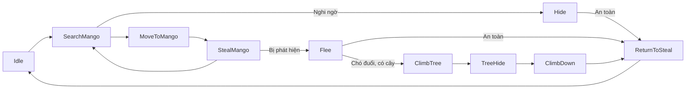

# AI kẻ trộm xoài — demo đầy đủ

## Mang chủ vườn sang và chơi

1. Dừng Play Mode, mở riêng **`Assets/ThiefAIGenerated/ThiefDemo.unity`**. Nếu scene đã mở từ trước khi cập nhật, lưu các chỉnh sửa bạn cần giữ rồi mở lại asset để nạp bản mới.
2. Mang **root nhân vật chủ vườn** sang scene: root có `gardenOwner`, `GardenPlayer`, `CharacterController`. Có thể dùng nhân vật đã setup trong demo GardenOwner; giữ các reference prefab kỹ năng trên nó. Không mang thêm mặt đất, grid hoặc camera của scene cũ.
3. Đặt chủ vườn trên mặt đất, ví dụ **Position `(0, 0.05, -11)`**, scale `(1,1,1)`. Layer nhân vật dùng Default hoặc layer nhân vật riêng, không dùng GardenGround/GardenObstacle. Bật `gardenOwner.readKeyboardInput` để điều khiển bằng bàn phím.
4. Nhấn Play. Component **`Demo Controls → ThiefDemoEnvironment`** tự gán grid/mask của demo cho chủ vườn, bổ sung prefab bẫy/chó/dép khi reference đang trống. Camera di chuyển được gán khi reference chưa có hoặc trỏ sang scene khác. Việc kết nối diễn ra lúc chạy, không sửa prefab gốc.
5. Điều khiển **WASD**, **Shift** chạy, **Space** nhảy, **Q** đặt bẫy, **E** gọi chó, **R** ném dép. Game view hiển thị **Owners connected**, state, số xoài, HP và mức nguy hiểm của từng trộm.

Bản demo có sẵn hai kẻ trộm, bốn cây xoài leo được và hai khối che chắn với tám điểm nấp. Các cây, quả, collider và anchor đã lưu trong Hierarchy, có thể chỉnh bằng Inspector trước khi Play. Menu **Tools → Thief AI → Create Demo Scene** tạo bản mới với cùng cấu trúc, lưu tên mới để giữ các scene cũ. ThiefDemoEnvironment chỉ dựng vườn lúc Start nếu orchardRoot chưa được gán, không tạo trùng vườn đã lưu.

Hai trộm mặc định chạy nhiệm vụ xoài, không tuần tra waypoint. Bảng demo có nút thử trói 2 giây và chuyển sang thử waypoint. Khi dùng waypoint, nút Next leg đổi Walk/Run cho chặng kế tiếp. Perception và phản ứng nguy hiểm vẫn hoạt động trong chế độ thử.

## Hành vi đã triển khai

| Tình huống | Phản ứng |
| --- | --- |
| Chưa có nguy hiểm | Quan sát, chọn cây có xoài nhìn thấy được và có đường A*, tiến tới điểm thu hoạch, hái từng quả và cộng vào inventory. |
| Thấy/nghe chủ vườn ở gần, chưa bị phát hiện | Chọn điểm nấp có vật cản thực sự che đường nhìn; cân nhắc hướng nhìn chủ vườn, quãng đường và độ gần nguy hiểm. Không mặc định lấy điểm gần nhất. |
| Chủ vườn nhìn thấy liên tục đủ thời gian hoặc đứng rất sát với LOS thông thoáng | Xác nhận bị phát hiện, ngừng hái và chạy trốn. |
| Mất dấu chủ vườn | Giữ vị trí nguy hiểm trong bộ nhớ; chỉ quay lại sau thời gian an toàn. |
| Cảm nhận được chó đang chọn mình làm Target | Tìm cây còn chỗ, leo được, có đường tới chân cây, tránh cây có chủ vườn đã quan sát đang chờ gần đó. Không có cây phù hợp thì chạy trốn. |
| Đến cây | Giành quyền sử dụng cây, leo liên tục qua các anchor, không teleport. Hai trộm không chiếm cùng cây một lúc. |
| Trên cây | Quan sát xung quanh; chờ chó/chủ vườn rời đi, hết bộ nhớ nguy hiểm và đủ thời gian an toàn. |
| Chuẩn bị xuống cây | Kiểm tra đường xuống và capsule tại điểm đáp, kể cả nhân vật đang chiếm chỗ. Chưa thể xuống thì tiếp tục chờ. Chó quay lại lúc đang xuống có thể khiến trộm leo lại. |
| Cây bị hủy | Dùng các anchor thế giới đã lưu để xuống liên tục; nếu đường bị chặn thì trả quyền cho controller/trọng lực thay vì đi xuyên vật cản. |
| Bẫy trói / mất HP | Trói tạm dừng di chuyển, hái và leo; hết trói tiếp tục. Hết HP hủy nhiệm vụ và phục hồi controller nếu đang leo. |

`GardenDog` hiện có kiểm tra khoảng cách **3D** khi cắn; hidePoint demo cao 3.6 m, nằm ngoài attackRange mặc định 1.6 m. Chó vẫn có thể cắn lúc trộm còn thấp. Không sửa `GardenDog`, `gardenOwner`, `GardenPlayer`, bẫy hoặc dép; chưa có hệ thống nhà tù/bắt giữ vĩnh viễn ngoài HP và Root đang có.

## FSM và module



Ưu tiên nguy hiểm được đánh giá riêng với state nhiệm vụ: chó → leo hoặc chạy; đã bị phát hiện → chạy; nghi ngờ → nấp hoặc chạy. Các state trên cây giữ quyền điều khiển riêng để tránh bị chuyển sang đi bộ giữa chừng. State được tạo một lần, không tạo mới mỗi frame. MoveToWaypoint vẫn giữ ID cũ để tương thích bản đầu.

| Script | Nhiệm vụ |
| --- | --- |
| `AI/ThiefAI.cs` | Điều phối FSM, ưu tiên nguy hiểm, sự kiện sát thương, vòng đời và API di chuyển. Tự bổ sung module thiếu cho instance từ bản cũ khi Awake. |
| `AI/States/ThiefState.cs` | Hợp đồng Enter/Tick/Exit và ID state. |
| `AI/States/ThiefIdleState.cs`, `ThiefMoveState.cs` | Nghỉ và kiểm thử waypoint. |
| `AI/States/ThiefGameplayStates.cs` | Các lớp state độc lập SearchMango, MoveToMango, StealMango, Hide, Flee, ClimbTree, TreeHide, ClimbDown, ReturnToSteal. |
| `AI/ThiefMotor.cs` | Bám đường `AStarGrid`, trọng lực/va chạm CharacterController, replan theo nhịp, giới hạn thử lại khi kẹt và báo lỗi. |
| `AI/ThiefPerception.cs` | OverlapSphereNonAlloc, thị giác/FOV, thính giác, LOS, xác nhận phát hiện và bộ nhớ vị trí đã cảm nhận. |
| `AI/ThiefTactics.cs` | Chấm điểm cây, chỗ nấp, cây leo và đường thoát; kiểm tra đường tới ứng viên bằng A*. |
| `AI/ThiefClimber.cs` | Độc quyền chuyển động khi leo, kiểm tra capsule, giữ chỗ cây, xuống an toàn, khôi phục controller và xử lý mất cây. |
| `AI/World/MangoTree.cs` | Stock xoài, điểm hái, hồi quả theo thời gian, sự kiện và visual quả. |
| `AI/World/ThiefInventory.cs` | Số xoài đã trộm, sức chứa tùy chọn, sự kiện khi đổi số lượng. |
| `AI/World/ThiefHideSpot.cs` | Điểm đứng sau vật che; vị trí có thể cấu hình bằng Transform. |
| `AI/World/ClimbableTree.cs` | Các anchor leo/ẩn và quyền chiếm cây. |
| `AI/ThiefAnimationDriver.cs` | Xuất tín hiệu hình ảnh từ trạng thái và chuyển động thực; animation không quyết định gameplay. |
| `AI/Demo/ThiefDemoEnvironment.cs` | Dựng vườn demo, rebuild grid và kết nối chủ vườn được thêm vào scene. |
| `AI/Demo/ThiefDemoHUD.cs` | Bảng trạng thái và các nút thử demo. |
| `AI/Editor/ThiefAISetup.cs`, `ThiefAIDemo.cs` | Setup có Undo, tạo/nâng cấp Animator Controller giữ Motion đã gán, tạo demo mới. |

## Perception và mức nguy hiểm

AI chỉ dùng vị trí chủ vườn/chó sau khi đối tượng đã được nhìn hoặc nghe trong phạm vi. Khi mất dấu, tactics dùng **snapshot vị trí** thay vì đọc vị trí hiện tại của đối tượng bị khuất. Cây/điểm nấp được đăng ký như các địa điểm của bản đồ; việc chọn cây xoài/cây leo còn phải thỏa tầm tìm và nhìn thấy điểm tiếp cận.

- Thị giác: `sightRadius`, `fieldOfView`, mắt `eyeHeight`, Linecast qua obstacleMask của grid.
- Thính giác: chủ vườn có CharacterController đang chuyển động trong `hearingRadius`; chó đang đuổi có thể được nghe trong bán kính này kể cả khi đứng dưới cây, mô phỏng tiếng sủa.
- Nhận biết chủ vườn: `cautionRadius`, `ownerSightRadius`, `ownerFieldOfView`, `ownerEyeHeight`. `OwnerNearby`, `OwnerLookingAtMe`, `OwnerConfirmed` là các tín hiệu riêng.
- Phát hiện: LOS/FOV của chủ vườn kéo dài `detectionDelay`, hoặc trong `immediateDetectionRange` với LOS rõ. Đây là mô hình xác nhận mới của module nhận biết; script điều khiển chủ vườn gốc không có AI thị giác riêng.
- Ghi nhớ/an toàn: `dangerMemory`, `dogMemory`, `dogSafetyRadius`, cộng thêm `ThiefAI.safeWait`, `minimumHideTime`, `minimumTreeTime`. Không về hái ngay khi mất một lần raycast.
- `sensingMask` phải bao gồm layer collider nhân vật/chó. Buffer nhận biết cố định 128 collider; giảm phạm vi/lọc layer nếu scene rất đông.

## Thiết lập trên nhân vật và bản đồ riêng

Chọn root trộm scale `(1,1,1)`, pivot tại chân, không có gardenOwner/GardenDog hoặc script khác ghi chuyển động. Chạy **Tools → Thief AI → Setup Selected Thief**. Root nhận CharacterController, GardenPlayer, ThiefMotor, ThiefPerception, ThiefTactics, ThiefClimber, ThiefInventory, ThiefAnimationDriver và ThiefAI. Đặt model/Animator làm con, bỏ collider phụ không cần thiết.

- Gán `ThiefMotor.navigationGrid`. Collider mặt đất thuộc **GardenGround**, thân cây/tường/khối che thuộc **GardenObstacle**. Hai mask này không chứa layer nhân vật/chó hoặc tán lá chỉ trang trí.
- Grid demo phủ 30 × 30 m, agentRadius 0.3 m, agentHeight 1.8 m, maxStepHeight 0.3 m. CharacterController cao 1.8, radius 0.3, center `(0,0.9,0)`, stepOffset 0.3. Cần đồng bộ kích thước, độ dốc và bậc với nhân vật của bạn.
- Gọi Rebuild sau khi đổi collider/layer bản đồ. Replan của motor không tự rebuild grid; vật cản động cần rebuildInterval hoặc gọi Rebuild rõ ràng.
- `ThiefAI.enableMangoMission = true`, `followTestWaypoints = false` để chơi nhiệm vụ. Inventory capacity 0 là không giới hạn. Nếu đầy sức chứa hữu hạn, AI dừng hái; chưa có luồng bán/nộp xoài.
- Cây xoài: gắn `MangoTree`, gán harvestPoint ở chân cây **ngoài collider thân**, interactionRange đủ phủ tâm ô A* có thể tiếp cận. Tùy chọn fruitVisuals, startingMangoes/capacity, regrowInterval (0 tắt hồi quả), onStockChanged.
- Cây leo: gắn `ClimbableTree`, gán climbStartPoint sát đất, climbEndPoint và hidePoint. Toàn bộ shaft phải đủ rộng cho capsule, tránh collider thân/tán; hidePoint phải cao hơn tầm cắn thực tế. Demo dùng điểm cách thân 1.6 m theo trục X, end cao 2.6 m, hide cao 3.6 m.
- Nơi nấp: gắn `ThiefHideSpot` tại điểm đứng đi được sau vật cản cao hơn mắt; có thể gán standPoint riêng. Cần có collider thật nằm trong obstacleMask, không chỉ model nhìn giống bụi cây.

## Animator và clip cần gắn

Controller **`Assets/ThiefAIGenerated/ThiefLocomotion.controller`** có đủ **Idle, Walk, Run, StealMango, Hide, Climb, TreeIdle, ClimbDown**. Motions còn trống để bạn gắn clip phù hợp rig/Avatar; capsule demo vẫn thể hiện chuyển động và state dù không có clip. Menu Create Locomotion Controller thêm phần còn thiếu vào controller hiện có và giữ các Motion đã gán.

| Parameter | Kiểu | Giá trị |
| --- | --- | --- |
| `isWalk`, `isRun` | Bool | Chuyển động ngang đo được và chế độ tốc độ của lệnh. |
| `Speed` | Float | Tốc độ ngang thực tế, đơn vị Unity/giây. |
| `Action` | Int | 0 locomotion, 1 hái, 2 nấp, 3 leo, 4 đứng trên cây, 5 xuống. |
| `AIState` | Int | ID FSM: Idle=0, MoveToWaypoint=1, SearchMango=2, MoveToMango=3, StealMango=4, Hide=5, Flee=6, ClimbTree=7, TreeHide=8, ReturnToSteal=9, ClimbDown=10. |

Any State → Idle/Walk/Run chỉ khi Action=0; các hành động khác chọn bằng Action. Không Exit Time, không self transition, blend 0.12 giây. Tắt Apply Root Motion; thời gian hái/leo do gameplay điều khiển. Driver bỏ qua parameter thiếu và không dùng Animation Event để cộng quả hoặc kết thúc leo.

## Chống kẹt, API và giới hạn

Motor giới hạn bước để không vượt waypoint, đi qua tâm ô bắt đầu để tránh cắt góc, replan theo `repathInterval`. Không có đường hoặc quá số lần `maxStuckRepaths` thì state chọn lại hành vi; cây không tới được bị bỏ qua 8 giây. Trói không tiêu hao số lần thử thoát kẹt. Không dịch chuyển nhân vật tới ô khác để chữa đường lỗi.

Tactics tránh đường đi sát vị trí nguy hiểm đã biết. Escape lấy mẫu vòng lớn rồi vòng nhỏ khi cần, ưu tiên tăng khoảng cách, đường ít nguy hiểm và endpoint có nhiều hướng đi được; `maxCandidatePaths` giới hạn số ứng viên chấm điểm. Đây là heuristic A*, không phải bảo đảm tối ưu chiến thuật trong mọi bản đồ.

Code không dùng NavMesh, không Find theo tag mỗi frame. Perception/tactics/bridge có nhịp riêng, registry cho cây/chỗ nấp và GardenPlayer. Các thông số tốc độ, tầm cảm nhận, cooldown, tìm cây, an toàn, hái, leo và thử lại được cấu hình trên các module ở Inspector.

```csharp
// Giữ reference từ Inspector; gọi sau Awake, ví dụ trong Start.
bool accepted = thiefAI.TryMoveTo(destination.position, run: true);
// accepted chỉ xác nhận có đường; kết quả theo Motor.Status / CurrentState.
thiefAI.ReturnToIdle();
```

Tắt mission/waypoint nếu dùng lệnh bên ngoài; phản ứng nguy hiểm vẫn ưu tiên. Lệnh di chuyển mới bị từ chối khi trói/chết/đang leo. ReturnToIdle chỉ hủy lệnh mặt đất, không cắt ngang cơ chế leo. `LastMoveFailure` lưu lỗi gần nhất. Bật logStateChanges để xem chuyển state; chọn nhân vật và bật Gizmos để xem tầm cảm nhận, ký ức nguy hiểm, đường đi, đích và điểm tactics chọn.

## Checklist kiểm tra trong Editor

- [ ] Không có chủ vườn: trộm tìm cây, tới điểm hái, đứng hái và tăng Mangoes; số quả trên cây giảm và hồi theo regrowInterval.
- [ ] Mang chủ vườn sang: Owners connected tăng, WASD/Shift/Space/Q/E/R hoạt động với grid demo.
- [ ] Tiếp cận nhưng quay lưng về trộm: trộm có thể chọn Hide sau vật cản; nhìn thẳng đủ lâu hoặc đứng rất sát: chuyển Flee.
- [ ] Đứng sau tường: không có phát hiện xuyên tường; thay đổi hướng nhìn/khoảng cách làm kết quả thay đổi.
- [ ] Rời xa: trộm chờ bộ nhớ nguy hiểm và safeWait rồi qua ReturnToSteal về nhiệm vụ.
- [ ] Gọi chó bằng E: trộm tìm cây leo còn chỗ hoặc chạy nếu không có cây; lên cao không bị cắn ngoài khoảng cách 3D thực tế.
- [ ] Chó hết lifetime hoặc bị hủy: trộm đợi an toàn, xuống từ từ, controller được bật lại; người đứng ở điểm đáp khiến trộm chờ.
- [ ] Hủy cây/đích/mất grid giữa lúc đang xử lý: không exception/teleport; AI đổi hành vi, dùng đường xuống đã nhớ hoặc trở lại va chạm/trọng lực.
- [ ] Bẫy/nút Root: dừng đi, hái hoặc leo trong thời gian trói; hết trói tiếp tục. Hết HP: ngừng nhiệm vụ.
- [ ] Hai trộm không cùng chiếm một cây; kho đầy không làm mất quả; không có đường thì không chạy xuyên vật cản.
- [ ] Gán model thật và clip: state animation phản ánh nhiệm vụ thực, không cần Animation Event để gameplay hoạt động.

## Kiểm chứng

Biên dịch với compiler đi kèm Unity **6000.3.8f1**, reference/define của dự án: **64 source runtime, 5 source Editor, 0 lỗi**. Có cảnh báo CS0169 ở Benchmark01 của ví dụ TextMesh Pro cũ.

Đã chạy kiểm thử hành vi trong Unity headless bằng project tạm, dùng cùng script gameplay và cùng ThiefDemoEnvironment để dựng vườn: thu hoạch/inventory, trói, nấp theo che khuất, xác nhận FOV/LOS, chạy tăng khoảng cách, chủ vườn biến mất, kết nối grid, chó chọn Target, leo liên tục, chờ/xuống và chết. Kết quả và các kiểm tra biên bổ sung được ghi trong `VALIDATION.md`. Cần kiểm tra model/clip và thao tác bàn phím bằng checklist trên trong scene thực.
